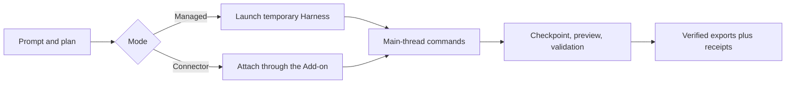

# Blender Design

## Plugin marketplaces

This plugin belongs to **AIGC content creation**.

| Category | Marketplace | Purpose |
| --- | --- | --- |
| Full-stack development | [Full Stack Plugins](https://github.com/partme-ai/full-stack-plugins) | Architecture and UI design, code understanding, quality checks, code review, workflow governance, and server operations |
| AIGC content creation | [Full AIGC Plugins](https://github.com/partme-ai/full-aigc-plugins) | Image, video, audio, music, 3D, and multimodal content creation |


> Build, review, and export editable Blender scenes from your coding agent through a guarded local Harness, with milestone previews and rollback checkpoints instead of disposable renders.

[](https://github.com/full-aigc-plugins/blender-design-plugin/releases) [](#skills) [](#installation) [](LICENSE)

[English](README.md) | [简体中文](README.zh-CN.md) · [Install](#installation) · [Quick start](#quick-start) · [Skills](#skills) · [Architecture](docs/Codex-Blender-Plugin-Architecture.md) · [Troubleshooting](#troubleshooting)

## Positioning

`blender-design` drives a real Blender session through a closed, structured command surface. It creates and edits scene objects, materials, lights, cameras and animation, captures milestone previews, and exports files you keep. Arbitrary Python is disabled by default, Blender data mutates only on the main thread, and irreversible actions require an action-bound authorization. The marketplace entry is `partme-ai-blender` pinned to `v0.16.1`, with one stdio MCP server, and the verified runtime baseline is Blender 4.2.23 in CI plus Blender 5.2.1 UI acceptance on macOS arm64.

## Installation

### Prerequisites

- Blender 4.2–5.2 installed and launchable; the checked matrix is `config/blender-release-matrix.json`.
- Python 3.11–3.13 available for the bundled MCP runtime.
- `ffmpeg` and `ffprobe` on `PATH` when you export video.
- Disk space for checkpoint snapshots and frame sequences.

### From the plugin marketplace

```bash
codex plugin marketplace add partme-ai/full-aigc-plugins
codex plugin add blender-design@full-aigc-plugins
```

Restart the host, open a new task, and start with a read-only request such as `capability.list` before changing anything.

### Optional: attach to an already-open Blender window

Run `python3 scripts/package_connector.py dist/partme-blender-mcp-addon-0.7.0-rc.2.zip`, install that ZIP in Blender via **Edit → Preferences → Add-ons → Install from Disk**, enable **PartMe Blender MCP**, then press `N` and click **Start MCP Server**. Do not install a second Blender MCP Add-on alongside it.

## Quick start



Ask for a scene, review the milestone previews, then export:

```text
Use managed mode. Create a matte-orange desktop speaker with a rounded body, a black front
grille, and one control knob. Show camera, front, side, and top previews, then export
.blend, .glb and .png into my output folder and verify every file.
```

Expected observation: Blender launches, the Harness loads temporarily, preview images appear per milestone, and the export step returns hashes instead of a success claim.

## What you can build

| Workflow | Built-in path | Verifiable output |
| --- | --- | --- |
| Model a product or environment | `blender-design`, `blender-hard-surface`, `blender-procedural-modeling` | Editable meshes, modifiers, Geometry Nodes groups |
| Rig and animate a character | `blender-character-rigging`, `blender-character-animation` | Armature, weights, IK controls, keyed action |
| Look development and render | `blender-uv-material`, `blender-render-compositing` | UV layout, PBR materials, Eevee/Cycles frames |
| White-model previs | `blender-previs`, `blender-video-original`, `blender-video-recreate` | Timed shots, camera motion, preview video |
| Review against a target | `blender-visual-loop`, `blender-design-loop` | Immutable screenshots, visual verdicts, committed transactions |
| Export and hand off | `blender-export`, `blender-to-dreamina`, `blender-seedance-pipeline` | `.blend`/`.glb`/`.png`/`.mp4` receipts, Jimeng handoff link |

## Skills

| Skill | What it does |
| --- | --- |
| `blender-ai-replication` | Replicates a reference image as 3D geometry through iterative vision critique. |
| `blender-asset-library` | Fetches CC0 HDRI and PBR assets with explicit download-size discipline. |
| `blender-background-jobs` | Runs snapshot-isolated exports, frame sequences and bakes off the foreground scene. |
| `blender-character-animation` | Animates a registered rig and one prop with IK, constraints and continuity checks. |
| `blender-character-rigging` | Builds armatures, skin weights, IK controls, pole targets and joint limits. |
| `blender-cinematography` | Designs cameras, lenses, path motion, focus, framing and handheld response. |
| `blender-connector` | Connects to an already-open Blender window through the pinned PartMe Add-on. |
| `blender-curves` | Builds editable paths, profiles, cables, rails and curve-driven props. |
| `blender-design` | Turns an idea into a scene through milestone modeling, materials, lights and animation. |
| `blender-design-loop` | Runs a dream → build → screenshot → critique → iterate loop against a target image. |
| `blender-export` | Exports an approved snapshot to verified model, image, video, EXR, USD or Alembic artifacts. |
| `blender-grease-pencil` | Creates Grease Pencil layers, materials, frame drawings and mixed 2D/3D scenes. |
| `blender-hair` | Creates and inspects Hair Curves from surface-local strand points and radii. |
| `blender-hard-surface` | Builds hard-surface, product, mechanical and prop geometry with registered commands. |
| `blender-harness` | Launches a managed session and dispatches the closed JSON command envelope. |
| `blender-harness-driving` | Drives the Harness from a shell client and keeps the scene-revision chain coherent. |
| `blender-inspect` | Inspects an active scene read-only before design, modification or export. |
| `blender-managed` | Starts a non-invasive session without installing a Blender Add-on. |
| `blender-mcp-setup` | Sets up or diagnoses the MCP connection, Add-on state and session discovery. |
| `blender-preview` | Captures camera, front, side and top previews for milestone review. |
| `blender-previs` | Turns a story or shot list into a colour-coded white-model previs video. |
| `blender-procedural-modeling` | Builds reusable Geometry Nodes systems and parameterized environments. |
| `blender-quality-validation` | Measures geometry, character, prop, collision, motion and camera acceptance criteria. |
| `blender-recover` | Rolls back a failed milestone or resumes from the last confirmed checkpoint. |
| `blender-render-compositing` | Configures Eevee/Cycles, passes, colour management, baking and compositor nodes. |
| `blender-retopology` | Sets up, projects, transfers layers for and validates retopology surfaces. |
| `blender-scene-assembly` | Organizes scenes, collections, object identity, transforms and visibility. |
| `blender-sculpt-surface` | Refines detail with masks, displacement, sculpt strokes, voxel remesh and Multires. |
| `blender-seedance-pipeline` | Drives a Blender preview through the validated Dreamina 3D pipeline. |
| `blender-sequence-editing` | Assembles VSE timelines with timing, speed, transitions and audio fades. |
| `blender-simulation` | Configures rigid body, collision, cloth, soft body, smoke and fluid caches. |
| `blender-to-dreamina` | Hands a local render to the official Jimeng uploader and returns a web link. |
| `blender-tracking` | Loads footage, creates markers, solves a camera and validates reprojection error. |
| `blender-use` | Routes a Blender request to the right managed or Connector workflow. |
| `blender-uv-material` | Prepares UVs and PBR materials including colour-space and normal-map semantics. |
| `blender-video-original` | Turns a prose concept into a timed, editable white-model video. |
| `blender-video-recreate` | Reconstructs a reference video's shots and camera motion as an editable scene. |
| `blender-visual-loop` | Iterates against a target with immutable screenshots and commit/rollback. |

## Slash commands

| Command | What it does |
| --- | --- |
| `/blender` | Entry point; routes design, previs, inspect, export and recovery requests. |
| `/blender-setup` | First-run setup: Add-on, connection mode and Harness preflight. |
| `/blender-design` | Milestone-based modeling, materials, lighting, camera and animation. |
| `/blender-inspect` | Scene and runtime inspection: objects, session, transactions, dependencies. |
| `/blender-preview` | Viewport snapshots and milestone screenshots for iterative review. |
| `/blender-previs` | White-model previs from a shot list plus the Seedance handoff package. |
| `/blender-render` | Final renders, compositor nodes and sequence output. |
| `/blender-export` | Verified multi-format export with receipts. |
| `/blender-recover` | Resume or roll back an interrupted job from the transaction ledger. |
| `/blender-dreamina` | Hand artifacts to the official Jimeng uploader. |
| `/blender-seedance` | Preview → validate → submit → download through Seedance. |

## MCP tools

`mcp.json` declares one stdio server, `partme_blender`, started with `node ./scripts/mcp_bootstrap.mjs`. It exposes the Harness command registry rather than free-form scripting:

| Tool | Purpose |
| --- | --- |
| `capability.list` / `capability.describe` / `preview.capture` | Read the catalog, describe the running mode, capture milestone previews |
| `scene.inspect` / `scene.screenshot` | Read the scene and grab a screenshot |
| `object.*`, `material.*`, `modifier.*` | Create and edit scene content on the main thread |
| `job.submit` / `job.status` / `job.resume` | Run and resume snapshot-isolated background work |
| `export.extended` | Export approved artifacts and return a receipt |

The generated inventory is `docs/verification/capability-counts.json`: 196 commands across 35 domains in managed mode, 201 across 36 in Connector mode.

## Configuration

| Variable | Purpose | Default |
| --- | --- | --- |
| `CODEX_BLENDER_DESCRIPTOR` | Path to the Harness session descriptor | Written by the launcher |
| `CODEX_BLENDER_FFMPEG` | Override the FFmpeg binary | `ffmpeg` on `PATH` |
| `CODEX_BLENDER_FFPROBE` | Override the ffprobe binary | `ffprobe` on `PATH` |

`config/blender-release-matrix.json` records supported builds and `config/production-profile.json` records excluded domains. No API key is stored: session authorization uses ephemeral HMAC tokens with a 60-second TTL.

## Architecture and security

Codex owns orchestration and approvals; Blender owns scene data; this plugin owns workflow instructions, the Harness transport and the validators. The authors receive no scene data.

- Transports are a private Unix domain socket on macOS, a Named Pipe on Windows, and tokenized loopback TCP only as a fallback.
- Deletion, overwrite, `expert_python`, path escape and budget overruns are gated by single-use, action-bound tokens.
- Checkpoints and the transaction journal live under the runtime directory; background jobs never restart by themselves, and a missing frame is detected by hash and re-rendered alone.

| Evidence | Status |
| --- | --- |
| macOS arm64 managed and Connector runtime | PASS, recorded in `docs/verification/harness-runtime.md` |
| Windows Server 2025 x64 background recovery, Rigify, Named Pipe | PASS, `docs/verification/windows-l4-rigify.md` |
| Windows foreground UI takeover and Jimeng Web handoff | Not verified or blocked; do not present either as working |

## Troubleshooting

| Symptom | Check first | Resolution |
| --- | --- | --- |
| Blender does not launch | Installation and `PATH` | Install Blender 4.2+ and retry managed mode |
| Video export fails | `ffmpeg` and `ffprobe` | Install both or set the two override variables |
| `UNKNOWN_COMMAND` | `capability.list` for this session | Use an advertised command or switch mode |
| `SESSION_REVOKED` | Authorization TTL | Re-authorize the action |

## Upgrade

```bash
codex plugin marketplace upgrade full-aigc-plugins
codex plugin add blender-design@full-aigc-plugins
```

Current packaged version: `0.16.1+codex.20261018` (development preview).

## Contributing and support

Open functional issues at <https://github.com/full-aigc-plugins/blender-design-plugin/issues>. State the Blender version and platform you verified on, whether the change alters the command registry or authorization policy, and include the affected tests. New commands belong in the registry, not in free-form Python.

## License

Apache-2.0 — see [LICENSE](LICENSE) and [NOTICE](NOTICE).
