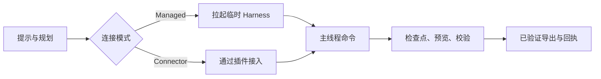

# Blender Design

## 插件市场导航

本插件所属分类：**AIGC 内容创作**。

| 分类 | 插件市场入口 | 用途 |
| --- | --- | --- |
| 全栈开发 | [Full Stack Plugins](https://github.com/partme-ai/full-stack-plugins) | 架构与 UI 设计、代码理解、质量检查、代码审查、流程治理与服务器运维 |
| AIGC 内容创作 | [Full AIGC Plugins](https://github.com/partme-ai/full-aigc-plugins) | 图像、视频、音频、音乐、3D 与多模态内容创作 |


> 在编码智能体里构建、审阅并导出可编辑的 Blender 场景：受控本地 Harness 负责结构化操作，里程碑预览与回滚检查点替代一次性渲染图。

[](https://github.com/full-aigc-plugins/blender-design-plugin/releases) [](#技能) [](#安装) [](LICENSE)

[English](README.md) | [简体中文](README.zh-CN.md) · [安装](#安装) · [快速开始](#快速开始) · [技能](#技能) · [架构文档](docs/Codex-Blender-Plugin-Architecture.zh_CN.md) · [故障排查](#故障排查)

## 项目定位

`blender-design` 通过一套封闭的结构化命令面驱动真实的 Blender 会话：创建和修改场景对象、材质、灯光、相机与动画，抓取里程碑预览，导出可长期保留的文件。默认禁用任意 Python 执行，Blender 数据只在主线程变更，不可逆操作必须携带与具体动作绑定的授权。市场条目为 `partme-ai-blender`，固定在 `v0.16.1`，包含一个 stdio MCP server；已验证的运行基线是 CI 中的 Blender 4.2.23 加 macOS arm64 上 Blender 5.2.1 的界面验收。

## 安装

### 前置条件

- 已安装并可启动 Blender 4.2–5.2，受检版本矩阵见 `config/blender-release-matrix.json`。
- 内置 MCP 运行时需要 Python 3.11–3.13。
- 导出视频时，`ffmpeg` 与 `ffprobe` 必须在 `PATH` 上。
- 为检查点快照与帧序列预留磁盘空间。

### 从插件市场安装

```bash
codex plugin marketplace add partme-ai/full-aigc-plugins
codex plugin add blender-design@full-aigc-plugins
```

重启宿主并新建任务，先执行只读的 `capability.list`，确认能力清单后再改场景。

### 可选：接入已打开的 Blender 窗口

执行 `python3 scripts/package_connector.py dist/partme-blender-mcp-addon-0.7.0-rc.2.zip`，在 Blender 中通过 **Edit → Preferences → Add-ons → Install from Disk** 安装该 ZIP，启用 **PartMe Blender MCP**，在 3D 视图按 `N` 后点击 **Start MCP Server**。不要同时安装第二个 Blender MCP 插件。

## 快速开始



提出场景需求，逐里程碑查看预览，再导出：

```text
用 managed 模式创建一个磨砂橙色桌面音箱：圆润机身、黑色前面板网罩、一个旋钮。
给出相机、正面、侧面、顶面四个预览；校验通过后把 .blend、.glb 和 .png
导出到我的输出目录，并逐个校验文件。
```

预期现象：Blender 启动、Harness 临时加载、每个里程碑产出预览图，导出步骤返回哈希而不是一句“已完成”。

## 可完成的工作

| 工作流 | 内置路径 | 可验证输出 |
| --- | --- | --- |
| 建模产品与环境 | `blender-design`、`blender-hard-surface`、`blender-procedural-modeling` | 可编辑网格、修改器、Geometry Nodes 组 |
| 角色绑定与动画 | `blender-character-rigging`、`blender-character-animation` | 骨架、权重、IK 控制器、关键帧动作 |
| 外观开发与渲染 | `blender-uv-material`、`blender-render-compositing` | UV 布局、PBR 材质、Eevee/Cycles 帧 |
| 白模预演 | `blender-previs`、`blender-video-original`、`blender-video-recreate` | 分镜时长、相机运动、预览视频 |
| 对照目标迭代 | `blender-visual-loop`、`blender-design-loop` | 不可变截图、视觉判定、已提交事务 |
| 导出与交接 | `blender-export`、`blender-to-dreamina`、`blender-seedance-pipeline` | `.blend`/`.glb`/`.png`/`.mp4` 回执、即梦交接链接 |

## 技能

| 技能 | 作用 |
| --- | --- |
| `blender-ai-replication` | 按参考图迭代生成 3D 场景，用视觉评审逐步收敛。 |
| `blender-asset-library` | 从 CC0 资产库获取 HDRI 与 PBR 素材，并约束下载体积。 |
| `blender-background-jobs` | 以快照隔离方式执行导出、帧序列与烘焙，不阻塞前景场景。 |
| `blender-character-animation` | 为已注册绑定和一个道具制作动画，含 IK、约束与连续性检查。 |
| `blender-character-rigging` | 构建骨架、蒙皮权重、IK 控制器、极向目标与关节限制。 |
| `blender-cinematography` | 设计相机、镜头、路径运动、对焦、构图与受控手持感。 |
| `blender-connector` | 通过固定版本 PartMe 插件接入已打开的 Blender 窗口。 |
| `blender-curves` | 构建可编辑路径、截面、线缆、轨道与曲线驱动道具。 |
| `blender-design` | 以里程碑方式完成建模、材质、灯光、相机与动画。 |
| `blender-design-loop` | 围绕目标图执行 dream → 构建 → 截图 → 评审 → 迭代闭环。 |
| `blender-export` | 将已批准快照导出为模型、图像、视频、EXR、USD 或 Alembic 并校验。 |
| `blender-grease-pencil` | 创建 Grease Pencil 图层、材质、逐帧绘制与 2D/3D 混合场景。 |
| `blender-hair` | 依据表面局部发丝点与半径创建并检查 Hair Curves。 |
| `blender-hard-surface` | 用已注册命令构建硬表面、产品、机械与道具几何。 |
| `blender-harness` | 启动 managed 会话并派发封闭的 JSON 命令信封。 |
| `blender-harness-driving` | 从 shell 客户端驱动 Harness，保持场景版本链一致。 |
| `blender-inspect` | 在设计、修改或导出前对场景做只读检查。 |
| `blender-managed` | 不安装 Blender 插件即可启动非侵入式会话。 |
| `blender-mcp-setup` | 配置或诊断 MCP 连接、插件状态与会话发现。 |
| `blender-preview` | 抓取相机、正面、侧面、顶面预览用于里程碑审阅。 |
| `blender-previs` | 把故事或镜头表转成带颜色编码的白模预演视频。 |
| `blender-procedural-modeling` | 构建可复用的 Geometry Nodes 系统与参数化环境。 |
| `blender-quality-validation` | 按明确对象、帧、代理体与容差度量几何、角色、道具、碰撞、运动与相机指标。 |
| `blender-recover` | 回滚失败的里程碑，或从最近确认的检查点继续。 |
| `blender-render-compositing` | 配置 Eevee/Cycles、渲染通道、色彩管理、材质烘焙与合成节点。 |
| `blender-retopology` | 建立、投影、传递数据层并验证可编辑重拓扑表面。 |
| `blender-scene-assembly` | 组织场景、集合、对象标识、变换与可见性。 |
| `blender-sculpt-surface` | 通过遮罩、置换、雕刻笔触、体素重构与 Multires 细化表面。 |
| `blender-seedance-pipeline` | 将 Blender 预览接入已验证的 Dreamina 3D 链路。 |
| `blender-sequence-editing` | 组装 VSE 时间线，含时长、变速、转场与音频淡入淡出。 |
| `blender-simulation` | 配置刚体、碰撞、布料、软体、烟雾与流体缓存。 |
| `blender-to-dreamina` | 将本地渲染交给官方即梦上传器并返回网页链接。 |
| `blender-tracking` | 载入素材、建立跟踪标记、解算相机并校验重投影误差。 |
| `blender-use` | 将 Blender 请求路由到合适的 managed 或 Connector 工作流。 |
| `blender-uv-material` | 准备 UV 与 PBR 材质，含纹理色彩空间与法线贴图语义。 |
| `blender-video-original` | 把文字创意转成有时序、可编辑的白模视频。 |
| `blender-video-recreate` | 将参考视频的镜头与相机运动还原为可编辑场景。 |
| `blender-visual-loop` | 以不可变截图、视觉判定与事务提交/回滚对照目标迭代。 |

## 斜杠命令

| 命令 | 作用 |
| --- | --- |
| `/blender` | 总入口：按设计、预演、检查、导出、恢复等意图路由。 |
| `/blender-setup` | 首次安装向导：插件、连接模式与 Harness 预检。 |
| `/blender-design` | 里程碑式建模、材质、灯光、相机与动画。 |
| `/blender-inspect` | 场景与运行时检查：对象、会话、事务、依赖。 |
| `/blender-preview` | 视口快照与里程碑截图，用于迭代确认。 |
| `/blender-previs` | 从镜头表生成白模预演与 Seedance 交接包。 |
| `/blender-render` | 成品渲染、合成节点与序列输出。 |
| `/blender-export` | 带校验回执的多格式导出。 |
| `/blender-recover` | 从事务账本续跑或回滚中断的作业。 |
| `/blender-dreamina` | 把产物交接给官方即梦上传器。 |
| `/blender-seedance` | 预览 → 校验 → 提交 → 下载的 Seedance 链路。 |

## MCP 工具

`mcp.json` 只声明一个 stdio server：`partme_blender`，由 `node ./scripts/mcp_bootstrap.mjs` 启动。它暴露 Harness 命令注册表，而不是自由脚本：

| 工具 | 用途 |
| --- | --- |
| `capability.list` / `capability.describe` / `preview.capture` | 读取能力清单、描述当前模式、抓取里程碑预览 |
| `scene.inspect` / `scene.screenshot` | 读取场景并截图 |
| `object.*`、`material.*`、`modifier.*` | 在主线程创建与编辑场景内容 |
| `job.submit` / `job.status` / `job.resume` | 运行并恢复快照隔离的后台作业 |
| `export.extended` | 导出已批准产物并返回回执 |

命令清单由 `docs/verification/capability-counts.json` 生成：managed 模式 196 条命令、35 个域；Connector 模式 201 条命令、36 个域。

## 配置

| 变量 | 用途 | 默认值 |
| --- | --- | --- |
| `CODEX_BLENDER_DESCRIPTOR` | Harness 会话描述文件路径 | 由启动器写入 |
| `CODEX_BLENDER_FFMPEG` | 覆盖 FFmpeg 可执行文件 | `PATH` 上的 `ffmpeg` |
| `CODEX_BLENDER_FFPROBE` | 覆盖 ffprobe 可执行文件 | `PATH` 上的 `ffprobe` |

`config/blender-release-matrix.json` 记录受支持的构建，`config/production-profile.json` 记录被排除的域。插件不保存任何 API Key：会话授权使用 60 秒默认有效期的临时 HMAC 令牌。

## 架构与安全

Codex 负责编排与审批，Blender 负责场景数据，本插件负责工作流指令、Harness 传输与校验器；作者不接收任何场景数据。

- 传输层在 macOS 使用私有 Unix domain socket，在 Windows 使用 Named Pipe，仅在回退时使用带令牌的环回 TCP。
- 删除、覆盖、`expert_python`、路径越界与预算超限都由一次性、动作绑定的令牌把关。
- 检查点与事务日志位于运行时目录；后台作业不会自行重启，缺帧由哈希发现并只补渲染该帧。

| 证据 | 状态 |
| --- | --- |
| macOS arm64 managed 与 Connector 运行时 | PASS，记录于 `docs/verification/harness-runtime.md` |
| Windows Server 2025 x64 后台恢复、Rigify、Named Pipe | PASS，见 `docs/verification/windows-l4-rigify.md` |
| Windows 前台界面接管与即梦网页交接 | 未验证或受阻，不得宣称可用 |

## 故障排查

| 现象 | 先检查 | 处理 |
| --- | --- | --- |
| Blender 未启动 | 安装情况与 `PATH` | 安装 Blender 4.2+ 后重试 managed 模式 |
| 视频导出失败 | `ffmpeg` 与 `ffprobe` | 安装两者，或设置两个覆盖变量 |
| 返回 `UNKNOWN_COMMAND` | 当前会话的 `capability.list` | 改用清单中已声明的命令，或切换模式 |
| 返回 `SESSION_REVOKED` | 授权有效期 | 重新授权该动作 |

## 升级

```bash
codex plugin marketplace upgrade full-aigc-plugins
codex plugin add blender-design@full-aigc-plugins
```

当前打包版本：`0.16.1+codex.20261018`（开发预览）。

## 贡献与支持

功能问题请提交到 <https://github.com/full-aigc-plugins/blender-design-plugin/issues>。说明你验证所用的 Blender 版本与平台、改动是否触及命令注册表或授权策略，并附上受影响的测试。新命令必须注册进注册表，不能以自由 Python 形式加入。

## 许可证

Apache-2.0，详见 [LICENSE](LICENSE) 与 [NOTICE](NOTICE)。
